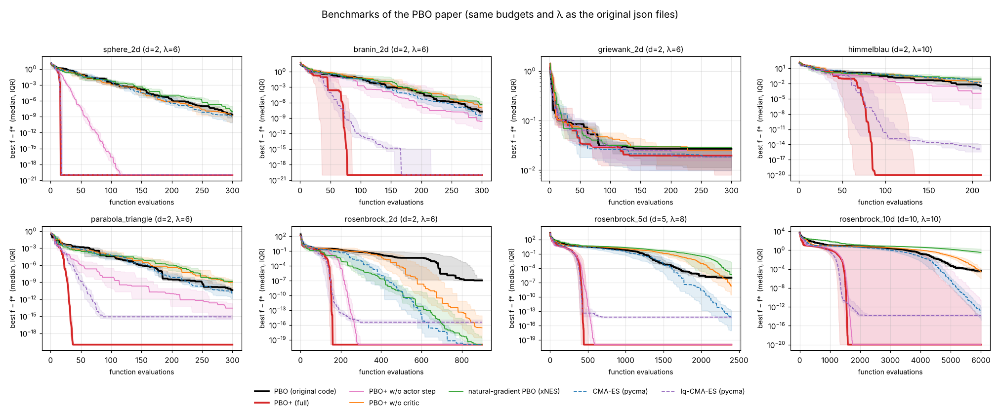
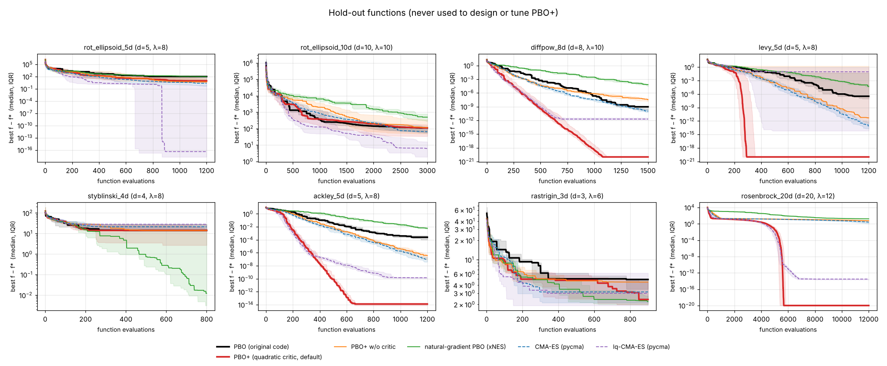

# PBO+ — policy-based optimization, rivista

Questo repository sviluppa **PBO+**, una versione migliorata del *Policy-Based Optimization*
di Viquerat et al. ([NCA 2023](https://link.springer.com/article/10.1007/s00521-022-07779-0),
[codice](https://github.com/jviquerat/pbo)), e la confronta con:

- il **PBO originale** (codice degli autori, in `baselines/pbo_original/`, eseguito con gli stessi file json del paper);
- **CMA-ES** e **lq-CMA-ES** (pycma, Hansen et al.);
- **TuRBO-1** (ottimizzazione bayesiana a regione di fiducia, Eriksson et al. 2019; implementazione in `baselines/turbo.py`).

I test coprono tre gruppi di problemi:

1. le funzioni analitiche del paper, con budget e popolazioni identici ai json originali;
2. un insieme di funzioni di controllo che **non** è mai stato usato per progettare o tarare PBO+ (verifica di generalizzazione);
3. **progetto di profili alari** (CST/Kulfan a 18–19 variabili + NeuralFoil), in vista dell'uso su problemi aerodinamici fortemente non lineari e multimodali.

## Risultati in breve

Tutti i confronti usano **lo stesso numero di valutazioni della funzione** e la stessa popolazione λ dei file json del paper. Il PBO originale gira con il suo codice. Le statistiche sono su 10 run indipendenti (5 per il PBO originale sulle funzioni di controllo, che è molto lento).



**Funzioni del paper**: valutazioni per raggiungere f − f* ≤ 1e-8 (mediana sui run riusciti; tra parentesi run riusciti/totali)

| problema | d | budget | PBO orig. | **PBO+** | CMA-ES | lq-CMA-ES |
|---|---|---|---|---|---|---|
| sphere_2d | 2 | 300 | 280 (8/10) | 16 (10/10) | 246 (8/10) | 17 (10/10) |
| branin_2d | 2 | 300 | 295 (3/10) | 34 (9/10) | 272 (6/10) | 72 (10/10) |
| griewank_2d | 2 | 300 | – (0/10), med f=0.03 | – (0/10), med f=0.02 | – (0/10), med f=0.02 | – (0/10), med f=0.02 |
| himmelblau | 2 | 210 | – (0/10), med f=0.003 | 70 (10/10) | – (0/10), med f=0.02 | 80 (10/10) |
| parabola_triangle | 2 | 300 | 185 (10/10) | 26 (10/10) | 190 (10/10) | 46 (10/10) |
| rosenbrock_2d | 2 | 900 | – (0/10), med f=1e-07 | 151 (10/10) | 452 (10/10) | 153 (10/10) |
| rosenbrock_5d | 5 | 2400 | – (0/10), med f=1e-06 | 414 (10/10) | 1805 (9/10) | 403 (9/10) |
| rosenbrock_10d | 10 | 6000 | – (0/10), med f=4e-05 | 1327 (8/10) | 5192 (10/10) | 1357 (9/10) |

**Funzioni di controllo (mai usate per la taratura)**: valutazioni per raggiungere f − f* ≤ 1e-8 (mediana sui run riusciti; tra parentesi run riusciti/totali)

| problema | d | budget | PBO orig. | **PBO+** | CMA-ES | lq-CMA-ES |
|---|---|---|---|---|---|---|
| rot_ellipsoid_5d | 5 | 1200 | – (0/5), med f=1e+02 | – (0/10), med f=9 | – (0/10), med f=2 | 667 (7/10) |
| rot_ellipsoid_10d | 10 | 3000 | – (0/5), med f=1e+02 | – (0/10), med f=1e+02 | – (0/10), med f=6e+01 | 2721 (1/10) |
| diffpow_8d | 8 | 1500 | 1161 (5/5) | 424 (9/10) | 1086 (10/10) | 447 (10/10) |
| levy_5d | 5 | 1200 | – (0/5), med f=3e-07 | 246 (8/10) | 811 (8/10) | 258 (4/10) |
| styblinski_4d | 4 | 800 | – (0/5), med f=1e+01 | 291 (3/10) | – (0/10), med f=2e+01 | 199 (2/10) |
| ackley_5d | 5 | 1200 | – (0/5), med f=0.0002 | 410 (10/10) | – (0/10), med f=9e-08 | 625 (9/10) |
| rastrigin_3d | 3 | 900 | – (0/5), med f=5 | 747 (1/10) | 695 (1/10) | – (0/10), med f=3 |
| rosenbrock_20d | 20 | 12000 | n/a | 5340 (9/10) | – (0/10), med f=3 | 5452 (10/10) |




Cosa si vede:

- **Rispetto al PBO originale**, PBO+ raggiunge la stessa precisione con un numero di valutazioni da 4 a 20 volte minore e arriva a precisioni che l'originale non raggiunge (Rosenbrock 10D: 1e-28 contro 4e-5 con lo stesso budget).
- **Rispetto a CMA-ES**, PBO+ è più veloce su tutti i problemi lisci. Il guadagno viene dal critico e dal passo attore: le ablazioni nella tabella completa (`results/summary.md`) mostrano che senza critico PBO+ torna al livello di CMA-ES.
- **Rispetto a lq-CMA-ES** (lo stato dell'arte dei surrogati locali) PBO+ è pari (entro il rumore fra seed) o migliore su 14 problemi su 16. È nettamente migliore su Branin, sulla parabola, su Lévy e su Ackley, e nettamente peggiore sugli **ellissoidi ruotati**. La causa è stata diagnosticata (vedi *Limiti*).
- Sulle funzioni multimodali (Griewank, Rastrigin, Styblinski) con budget così piccoli nessun metodo trova regolarmente il minimo globale; PBO+ è tra i migliori.

<!-- AIRFOIL -->

## Limiti noti (onestamente)

- **Gomiti nella mappatura delle azioni.** La convenzione del PBO originale (azione 0 = punto iniziale x₀, pendenze diverse ai due lati) introduce una discontinuità della derivata in a_i = 0 quando x₀ non è al centro del dominio. Sugli ellissoidi ruotati mal condizionati (1e5–1e6) questo blocca PBO+, CMA-ES e il PBO originale, mentre lq-CMA-ES ne risente meno. Con la stessa funzione e una mappatura senza gomito, PBO+ risolve l'ellissoide 6D in 6 run su 6 (1e-29). Per questo i problemi di profilo alare usano una mappatura senza gomito, uguale per tutti gli algoritmi.
- Il critico GP ha un costo computazionale (circa 1 s per generazione in 18D): è irrilevante quando una valutazione è una CFD, non lo è per funzioni analitiche.
- Gli iperparametri di PBO+ (taglia del modello, soglia di τ, σ₀ per i profili) sono stati scelti sulle funzioni del paper e su un insieme di sviluppo separato. Le funzioni di controllo sono state valutate una sola volta; sull'ellissoide di controllo la diagnosi del gomito è stata fatta dopo, su un ellissoide di sviluppo diverso.
- NeuralFoil è un surrogato di XFOIL: un ottimizzatore può sfruttarne gli errori. Il vincolo su `analysis_confidence` lo limita, ma i profili migliori vanno verificati con XFOIL o RANS.


## Cosa cambia rispetto al PBO

Il PBO è un gradiente di policy *single-step*: una gaussiana N(μ, Σ), prodotta da tre reti con ingresso costante, viene migliorata con una loss in stile REINFORCE/PPO sui vantaggi normalizzati di ogni generazione. PBO+ mantiene questa visione (una policy gaussiana migliorata da batch di ricompense single-step) e cambia **come si parametrizza la policy, come si stima il vantaggio, come si calcola il passo e da dove arrivano le azioni**.

| # | Modifica | Perché | Riferimento |
|---|---|---|---|
| 1 | μ, σ, C come parametri diretti, al posto delle reti con stato costante | con ingresso costante la rete è solo una riparametrizzazione mal condizionata degli stessi 2d + d(d−1)/2 numeri; Adam sui pesi non vede la geometria della gaussiana | discussione nel paper PBO stesso |
| 2 | **gradiente naturale** della policy (Fisher) | il passo diventa invariante per trasformazioni lineari dello spazio di progetto; spariscono i learning rate | xNES, Glasmachers et al. 2010; IGO, Ollivier et al. 2017 |
| 3 | **cumulazione**: momentum del passo della media (evolution path, rank-one) e controllo del passo per lunghezza del cammino (CSA) | è esattamente ciò che il PBO cerca di imitare con il buffer storico dell'ultima media e con il decadimento dei vantaggi; con λ piccolo (6–12, come nel paper) è la componente che pesa di più | CMA-ES, Hansen & Ostermeier 2001 |
| 4 | utilità basate sul **rango** invece di vantaggi z-score clippati | invarianza per trasformazioni monotone della ricompensa; robustezza a valori anomali (una CFD divergente non distrugge il gradiente) | NES, Wierstra et al. 2014 |
| 5 | **critico Q(a)**: surrogato locale (lineare → quadratico diagonale → quadratico completo) nelle coordinate della policy, z = A⁻¹(x−m) | ordina gratuitamente tutte le azioni campionate; si valutano con la funzione vera solo quelle su cui il critico non è affidabile | lq-CMA-ES, Hansen 2019 |
| 6 | valutazione **incrementale**: a blocchi crescenti, finché il τ di Kendall del critico sulle ultime valutazioni vere supera 0.85; le azioni non valutate ricevono il valore del critico più uno scostamento pessimista | quando il critico è buono una generazione costa 1–2 valutazioni vere invece di λ | lq-CMA-ES |
| 7 | **passo attore dal critico** (stile DDPG): quando il critico è un quadratico convesso, il suo minimo (passo di Newton in una regione di fiducia di raggio √d+2 in unità di σ) viene iniettato nella popolazione, con il clipping della lunghezza di Mahalanobis per l'aggiornamento della covarianza | sfrutta la curvatura appresa: nelle ablazioni è la singola modifica più utile su Himmelblau, Branin e parabola | injection: Hansen 2011 |
| 8 | **critico GP** opzionale (Matérn 5/2, ARD, iperparametri per massima verosimiglianza marginale) | per paesaggi non quadratici, come i profili alari | — |
| 9 | riflessione ai bordi: la policy ottimizza f∘reflect, quindi il gradiente resta corretto | il PBO originale clippa le azioni in [−1, 1]: questo distorce il gradiente vicino ai bordi | — |
| 10 | restart (IPOP / BIPOP / restart basati sui bacini con nearest-better clustering dell'archivio) | multimodalità | Auger & Hansen 2005; Hansen 2009; Preuss 2010 |
| 11 | **separazione costo economico / costoso** (`cheap=`): le penalità note senza solutore (vincoli geometrici) vengono calcolate esattamente su ogni candidato; il critico modella solo la parte aerodinamica, e il passo attore viene accorciato finché resta ammissibile | le penalità del tipo max(0, ·) hanno spigoli che nessun surrogato liscio rappresenta bene; separate, la parte restante è liscia. Sui profili alari è la modifica più efficace | idea dei *known constraints*, Gelbart et al. 2014; screening dei vincoli economici |
| 12 | **valutazione a batch** (`optimize(f, budget, batch=True)`, `min_batch`): ogni blocco deciso dal critico viene valutato in parallelo | CFD su cluster: si lanciano `min_batch` simulazioni insieme | — |
| 13 | **portafoglio** di policy con archivio condiviso e successive halving (`pboplus/portfolio.py`) | multimodalità in bassa dimensione: aiuta su Schwefel, Eggholder e Michalewicz; in 18D con 1000 valutazioni invece peggiora, perché dividere il budget costa troppo | Jamieson & Talwalkar 2016 |

Lavori correlati che miglioranti il PBO o le idee vicine, studiati per questo lavoro:

- **PPO-CMA** (Hämäläinen et al. 2020, [paper](https://arxiv.org/abs/1810.02541), [codice](https://github.com/ppocma/ppocma)): reti separate per media e varianza, storia per la varianza, solo vantaggi positivi. È proprio l'origine delle euristiche del PBO; PBO+ fa il passo successivo, sostituendole con le grandezze esatte che quelle euristiche approssimano.
- **Mixed-variable PBO** (Viquerat 2025, [arXiv 2506.13240](https://export.arxiv.org/abs/2506.13240)): estende il PBO a variabili discrete con policy categoriche. È ortogonale a questo lavoro.
- **lq-CMA-ES** (Hansen 2019, [GECCO](https://dx.doi.org/10.1145/3321707.3321842)): la fonte dei punti 5 e 6.
- **ShapeBench** (2026, [codice](https://github.com/Research-code-4378/ShapeBench)): benchmark di ottimizzazione aerodinamica di forma; il problema `af_ld_m02_re1e7` ne riproduce il task NeuralFoil «L/D vincolata, M = 0.2, Re = 1e7».
- **NeuralFoil** (Sharpe 2025, [arXiv 2503.16323](https://arxiv.org/abs/2503.16323)): surrogato neurale di XFOIL, circa 5 ms per valutazione.
- **evosax** (Lange 2022, [arXiv 2212.04180](https://arxiv.org/abs/2212.04180)): libreria di ES, utile come riferimento di implementazione.
- **MSC-CMA-ES** (2026): restart consapevoli dei bacini; ha ispirato `restart_mode='nbc'`.

## Struttura

```
pboplus/core.py        PBO+ (policy, gradiente naturale, critico, attore, restart)
pboplus/gp.py          critico GP (Matérn 5/2 ARD) e critico 'auto'
pboplus/portfolio.py   portafoglio di policy con successive halving
examples/su2_airfoil_template.py   accoppiamento con SU2 a batch paralleli
pboplus/benchmarks.py  funzioni del paper + controllo + sviluppo multimodale
pboplus/airfoil.py     problemi di profilo alare (CST + NeuralFoil)
baselines/pbo_original PBO originale (patch minima per NumPy 2 / TF 2.21)
baselines/turbo.py     TuRBO-1
bench/                 script di benchmark e confronto, dati grezzi (.npy, log originali)
results/               figure e tabelle
tests/                 test
```

## Come riprodurre

```bash
pip install numpy scipy matplotlib cma neuralfoil aerosandbox pytest
export OMP_NUM_THREADS=1                          # importante: evita l'oversubscription BLAS
python -m pytest tests
python bench/run_variants.py --problems sphere_2d,rosenbrock_5d --seeds 10 --cpu 4
bench/run_original.sh rosenbrock_5d               # PBO originale (TensorFlow, TF_USE_LEGACY_KERAS=1)
python bench/compare.py                           # figure e tabelle in results/
```

Uso diretto:

```python
from pboplus.core import PBOPlus
opt = PBOPlus(dim=18, lam=12, sigma0=0.25, seed=0)     # azioni in [-1, 1]^d
x_best, f_best = opt.optimize(f, budget=1000)          # f da minimizzare
```
